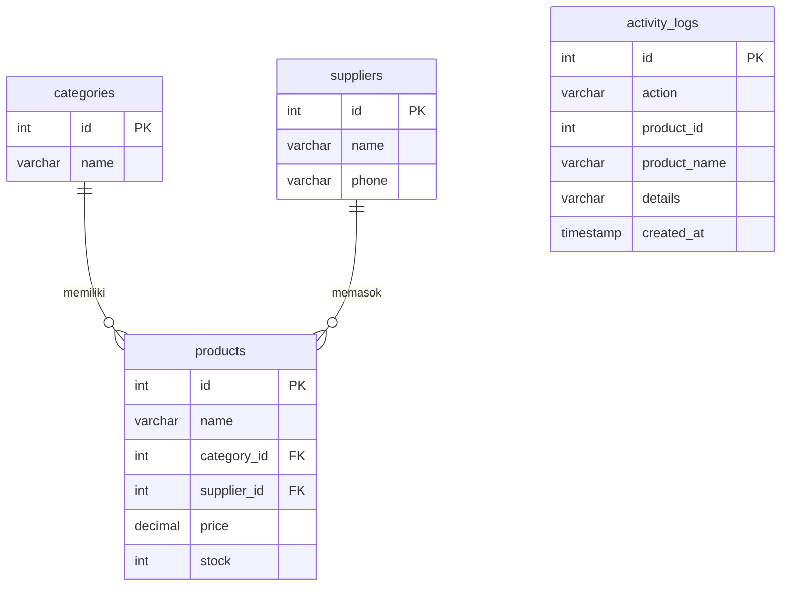

# CRUD Inventaris — Tugas Rutin 8

Aplikasi CRUD inventaris barang sederhana dengan **PHP native + PDO + MySQL**.
Tugas Rutin 8 · Pemrograman Web (3KOM40115) · Pertemuan 8 — *RDBMS & Integrasi PHP-MySQL*.

> **Nama:** Gomgom Tua Antonius Naibaho    
> **NIM:** 4253250008                   
> **Kelas:** PSIK25A

## Fitur

| Fitur | File |
|---|---|
| **Read** — daftar produk + nama kategori & supplier (JOIN 3 tabel) | `index.php` |
| **Create** — form tambah dengan dropdown kategori & supplier | `create.php` |
| **Update** — form edit yang sudah terisi (pre-filled) | `edit.php` |
| **Delete** — hapus dengan konfirmasi (POST + `confirm()`) | `delete.php` |
| Flash message sukses/gagal (pola Post/Redirect/Get) | `includes/helpers.php` |
|pencarian produk | `index.php` (`?q=`) |
|transaction + log aktivitas (create/update/delete) | `delete.php`, `create.php`, `edit.php`, `logs.php` |

## Struktur Proyek

```
TugasWeb-Pertemuan8-CRUD/
├── config/
│   └── database.php        # Koneksi PDO — Singleton pattern
├── includes/
│   ├── helpers.php         # e(), flash message, redirect, validasi, log
│   ├── header.php
│   ├── footer.php
│   └── product_form.php    # form bersama untuk create & edit
├── assets/
│   └── style.css
├── docs/screenshots/       # taruh screenshot di sini
├── schema.sql              # DDL + seed data
├── index.php               # READ
├── create.php              # CREATE
├── edit.php                # UPDATE
├── delete.php              # DELETE
├── logs.php                # riwayat aktivitas (bonus)
└── README.md
```

## Desain Database (3NF)



- Relasi **One-to-Many**: 1 kategori → banyak produk, 1 supplier → banyak produk (FK berada di sisi *many*, yaitu `products`).
- Data kategori dan supplier disimpan **satu kali saja** (tidak berulang di tabel produk) sehingga memenuhi 3NF.
- `activity_logs` (bonus) sengaja tanpa FK agar riwayat tetap ada walaupun produknya sudah dihapus.
- Seed data: minimal 5 baris per tabel (`schema.sql`).

## Keamanan

-  **Semua query yang melibatkan input user memakai prepared statements** (`prepare()` + `execute()`), tidak ada concatenation string SQL.
-  `PDO::ATTR_EMULATE_PREPARES => false` (real prepared statement), `ERRMODE_EXCEPTION`, `FETCH_ASSOC`.
-  Cast tipe `(int)` / `(float)` untuk id, harga, dan stok + validasi di sisi server.
-  Semua output ke HTML dibungkus `htmlspecialchars()` lewat helper `e()` (pencegahan XSS).
-  Hapus data hanya lewat **POST** (bukan link GET), dengan konfirmasi.
-  Detail error database hanya ditulis ke log server (`error_log`), tidak ditampilkan ke pengguna.

## Cara Menjalankan (Import Database)

**Kebutuhan:** XAMPP atau Laragon (PHP 7.4+ dan MySQL/MariaDB).

1. **Salin proyek** ke folder web server:
   - XAMPP → `C:\xampp\htdocs\TugasWeb-Pertemuan8-CRUD`
   - Laragon → `C:\laragon\www\TugasWeb-Pertemuan8-CRUD`
2. **Jalankan** Apache dan MySQL (XAMPP Control Panel / Laragon → *Start All*).
3. **Import database** — pilih salah satu:
   - **phpMyAdmin:** buka `http://localhost/phpmyadmin` → tab **Import** → pilih file `schema.sql` → **Go**.
   - **Terminal:** `mysql -u root < schema.sql`
4. **Buka aplikasi:** `http://localhost/TugasWeb-Pertemuan8-CRUD/`

Jika user/password MySQL Anda bukan `root` / kosong, ubah nilai default di `config/database.php`
atau set environment variable `DB_HOST`, `DB_NAME`, `DB_USER`, `DB_PASS`.

## Screenshot

> Ganti placeholder di bawah dengan screenshot aplikasi Anda (simpan di `docs/screenshots/`).

| Halaman | Screenshot |
|---|---|
| Daftar produk (JOIN) | `` |
| Form tambah (dropdown) | `` |
| Form edit (pre-filled) | `` |
| Konfirmasi hapus | `` |
| Flash message sukses | `` |
| Riwayat aktivitas | `` |
